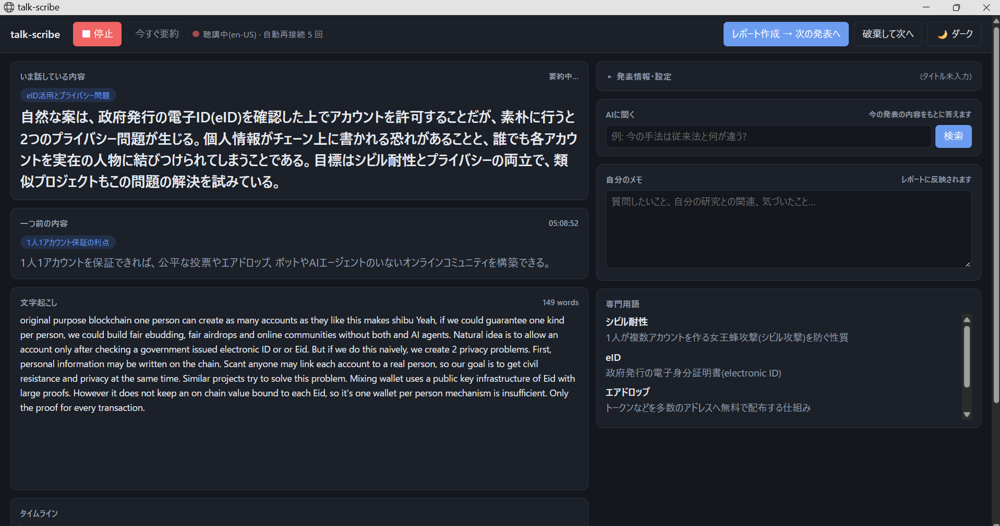

# talk-scribe

研究発表・講演・会議を聞きながら、話している内容をリアルタイムで文字起こし・要約し、終わったらレポート(会議なら議事録)を作るツールです。英語の発表を日本語の要約で追いかける、会議の決定事項と ToDo を残す、といった使い方を想定しています。



- **ライブ要約**: 数十秒ごとに、いま話している内容を要約。専門用語の説明とタイムラインも表示
- **3 つの場面**: 研究発表 / 講演・セミナー / 会議 に合わせて、要約の観点とレポートの構成が変わる(会議なら決定事項・ToDo 入りの議事録)
- **AIに聞く**: 聞き逃したところや分からなかったところを質問すると、今の話をもとに答えてくれる
- **レポート・議事録**: 終わったらボタン 1 つで作成(`.md` / 図入りの `.pdf`)。作成中もすぐ次を聞き始められる
- **LLM を選べる**: Claude / ChatGPT / ローカル LLM(Ollama・LM Studio など)。要約とレポートで別の LLM も使える

## 必要なもの

- Python 3.10 以上
- **Microsoft Edge**(推奨)または Google Chrome。文字起こしにブラウザの音声認識(Web Speech API)を使います
- マイク(ノート PC 内蔵でも可。外付けマイクを話者側に向けると精度が上がる)
- インターネット接続(ブラウザの音声認識がクラウドを使うため)
- 次のどれか: Anthropic の API キー / OpenAI の API キー / OpenAI 互換 API を持つローカル LLM

## セットアップ

```bash
git clone <このリポジトリ>
cd talk-scribe
pip install -r requirements.txt   # anthropic / openai / markdown
cp .env.example .env      # Windows: copy .env.example .env
```

`.env` を開いて、使う LLM を設定します(次の節)。

## LLM の設定(.env)

使う LLM に合わせて、次のどれかを `.env` に書きます。

例: Claude(既定。モデルは要約 `claude-sonnet-5-5`、レポート `claude-opus-5-5`)

```ini
ANTHROPIC_API_KEY=sk-ant-...
```

例: ChatGPT

```ini
LLM_PROVIDER=openai
OPENAI_API_KEY=sk-...
SUMMARY_MODEL=<要約に使うモデル名>
REPORT_MODEL=<レポートに使うモデル名>
```

例: Ollama(`ollama pull qwen2.5:14b` 済みの場合)

```ini
LLM_PROVIDER=local
SUMMARY_MODEL=qwen2.5:14b
REPORT_MODEL=qwen2.5:14b
# Ollama 以外のサーバーを使うときは接続先を書く(既定は http://localhost:11434/v1)
# LOCAL_BASE_URL=http://localhost:1234/v1
```

例: 要約はローカル LLM で無料に、レポートだけ Claude で

```ini
SUMMARY_PROVIDER=local
SUMMARY_MODEL=qwen2.5:14b
REPORT_PROVIDER=anthropic
ANTHROPIC_API_KEY=sk-ant-...
```

- 「AIに聞く」はライブ要約と同じ LLM を使います。変えたいときは `ASK_PROVIDER` / `ASK_MODEL` を書きます。
- ローカル LLM は、OpenAI 互換の `/v1/chat/completions` を持つサーバーなら使えます(Ollama、LM Studio、llama.cpp server、vLLM など)。
- 小さいモデルだと、要約が崩れることがあります。
- 設定が足りないときは、起動時にエラーで知らせます。

## 使い方

```bash
python server.py               # Edge のアプリウィンドウで http://localhost:8765 が開く
python server.py --no-browser  # ブラウザを開かない
```

1. 設定欄で **場面**(研究発表 / 講演・セミナー / 会議)・音声言語(例: English (US))・要約言語・**レポート形式**を選び、タイトル(会議なら会議名)などを入力する
2. **● 聴講開始** を押してマイクを許可する。文字起こしが流れ、設定した間隔ごとに要約が更新される
3. 気づいたことは「自分のメモ」に書く(レポートに反映される)。分からないことは「AIに聞く」に入力して **質問**(Enter でも可)
4. 終わったら **レポート作成 → 次の発表へ**(会議なら **議事録作成 → 次の会議へ**)。画面はすぐ次の用に空になる(音声認識は止まらない)
5. 下の「レポート」一覧に作成状況が出る。完成すると `reports/` に自動保存され「✓ 保存済み」になる。クリックで中身を表示・コピーでき、**保存先を開く** でフォルダを開ける。失敗したものは **再作成** できる
6. レポートが不要なときは **破棄して次へ**

止めるときは、起動したターミナルで **Ctrl + C**。すでに起動しているのにもう一度起動すると「ポート 8765 は使用中です」と出て止まります。

## 保存されるもの

| 場所                       | 内容                                                                                                                     |
| -------------------------- | ------------------------------------------------------------------------------------------------------------------------ |
| `reports/<日時_タイトル>/` | 1 件ごとのフォルダ。レポート・議事録(`report.md` / `report.pdf`、レポート形式の設定による)と文字起こし(`transcript.txt`) |
| `logs/speech.log`          | 音声認識のイベント(開始・終了・エラー・自動再接続)。不調の調査用                                                         |
| ブラウザ(localStorage)     | 今の文字起こし・要約・メモ・設定。再読み込みしても消えない                                                               |

`reports/`、`logs/`、`.env` は `.gitignore` 済みです。

### PDF について

- 1 ページ目に図解(主な数字のカード・内容の流れ・比較の棒グラフ・時間ごとの話題)、2 ページ目以降にレポート本文が入ります。
- 「聞き取り不確実」「要確認」とされた数値は図に載せません。
- PDF への変換には Edge(なければ Chrome / Chromium)を使います。見つからない・失敗したときは、文章を `.md` で保存して知らせます。

## データの送り先について

- **音声**: ブラウザの音声認識サービスに送られます(Edge は Microsoft、Chrome は Google)。
- **文字起こし・メモ**: 要約とレポートのため、設定した LLM の提供元に送られます(ローカル LLM なら PC の外に出ません)。
- 録音・文字起こしの扱いは、学会・イベント・組織ごとに決まりがあります。利用前に確認し、会議では参加者の同意を得てください。

## 費用の目安(Claude の既定設定)

| 機能             | 使うモデル                               | 費用の目安                                                        |
| ---------------- | ---------------------------------------- | ----------------------------------------------------------------- |
| ライブ要約       | Claude Sonnet 5.5                        | 1 時間あたり約 0.7 ドル(30 秒間隔の場合。60 秒間隔にすると約半分) |
| レポート・議事録 | Claude Opus 5.5(PDF の図解は Sonnet 5.5) | 1 件あたり約 0.2〜0.3 ドル(PDF にすると約 0.015〜0.03 ドル増える) |
| AIに聞く         | Claude Sonnet 5.5(ライブ要約と同じ)      | 1 回あたり約 0.01〜0.03 ドル(話の長さによる)                      |

トークン数からの見積もりで、話の長さや話す速さで変わります。最新の料金は [Claude の料金ページ](https://claude.com/pricing#api) を確認してください。API 呼び出しごとのトークン数はサーバーのログに出ます。ローカル LLM なら API の費用はかかりません。

## 注意: Edge の音声認識は定期的に切れる

Edge の音声認識サービスは、数分ごとに接続を切ります。アプリ側で自動的に再接続しますが、再接続のあいだ(1 秒ほど)の発話は文字にならず、文の途中で切れることもあります。

これを避けるよい方法をご存じの方は、ぜひ Pull Request をお願いします。

## ファイル構成

```
server.py      ローカルサーバー(画面の配信・要約・レポートの作成)
llm.py         LLM プロバイダの切り替え(Claude / OpenAI / OpenAI 互換)
pdf.py         レポートを図入りの PDF にする
index.html     画面(音声認識・表示)
.env.example   設定の見本
```

## ライセンス

MIT License(`LICENSE` を参照)
